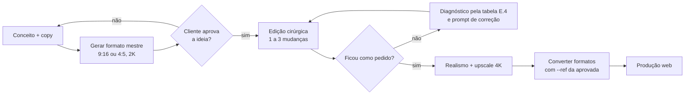

# Edição iterativa — do primeiro resultado à peça final

Método validado no caso de telemedicina (G01, G02). Imagem de nível profissional
quase nunca sai pronta na primeira geração: ela é **gerada uma vez e lapidada
por edições cirúrgicas**, sempre a partir da última versão aprovada.



---

## E.1 Regras do ciclo

1. **Sempre edite a última versão aprovada**, nunca uma intermediária. Editar
   uma versão antiga fez o homem desaparecer da peça (caso G01).
2. **Use o arquivo 2K gerado** como referência, nunca print de tela.
3. **No máximo 3 mudanças por edição.** Se o resultado desandar, separe em
   passadas de 1 mudança cada.
4. **Congele o que já foi aprovado** com o bloco PRESERVE EXACTLY em toda edição.
5. **Diga o que remover com nome e posição** ("the small texts at the top left
   and top right"), não "limpe a imagem".
6. **Leia o pedido do cliente pelo resultado esperado**, não pela palavra:
   "acrílico no lugar do verde" significava vidro em degradê sobre a foto, não
   um card de vidro.
7. **Copy acompanha a imagem:** ao incluir o homem, "Saúde feminina" virou
   contradição e precisou mudar.

---

## E.2 Template de prompt de edição

```text
Edit the provided image. Keep it the same {ASPECT} photograph with the same overlay style. Change only the items listed below.

PRESERVE EXACTLY
- {PESSOAS}: the same people, unchanged: facial features, expressions, gaze, skin tones, hair, clothing, poses and positions. Do not retouch, beautify, reshape, age or move them.
- {FUNDO/LUZ}: same camera angle, light, color grade and texture.
- {TEXTO QUE FICA}: "…" with the same font, size, weight, color, line break and position.
- {ELEMENTOS DE INTERFACE QUE FICAM}.

REMOVE
1. {ELEMENTO + POSIÇÃO}.
2. …
Restore clean, natural {background} wherever these elements were, with no traces, ghosts or smudges.

CHANGE / ADD
- {UMA INSTRUÇÃO POR ITEM, com posição em % e material}.

TEXT RULES
Render all text exactly as written, with correct Brazilian Portuguese accents. No other text.

DO NOT
- {ERROS JÁ VISTOS NESTA PEÇA: card, halo no botão, linhas extras, textos do topo…}
```

Não escrever `identity`/`same face` em prompt com imagem anexada: pode
disparar o filtro de política (bloqueio PlantMed). Use "the same people,
unchanged: facial features, expressions".

## E.3 Duas referências (IMAGE 1 / IMAGE 2)

Para trazer uma pessoa ou um estilo de outra imagem:

```text
You are given two images.
IMAGE 1 is the base image to edit. IMAGE 2 is a reference used only for {o que usar}; take nothing else from IMAGE 2.
```

```bash
uv run …/generate.py --prompt-file edit.txt --out v3.png --aspect 9:16 --size 2K \
  --ref base-aprovada.png --ref fonte-do-elemento.png
```

A ordem dos `--ref` define IMAGE 1 e IMAGE 2.

Usos validados:
- trazer o homem de uma versão antiga para a versão nova (G01);
- copiar o estilo do botão de outra peça (G02).

---

## E.4 Diagnóstico — erros reais e correções

| Sintoma | Causa provável | Correção |
|---|---|---|
| Vidro virou **card** com borda e sombra | Prompt disse "panel/inset/rounded corners" | Usar `interface-vidro.md §V.1` (degradê, "not an object") |
| **Bloco verde liso** cobrindo o topo e apagando o fundo | Modelo criou área "limpa" para o título | `Remove the flat solid area. Extend the real {background} all the way to the top edge` + degradê de vidro |
| **Véu verde/escuro** em volta do botão | Modelo protege a leitura do texto branco | Proibir blur/tint/halo; escurecer a roupa atrás; ou botão em HTML |
| Botão saiu **sólido** quando se queria contorno | Prompt pediu fill | `thin white outline, fully transparent inside, no fill` |
| **Pessoa sumiu** | Edição partiu de versão antiga | Duas referências (E.3) |
| **Linhas verticais** e linhas extras | Modelo copiou guias da referência | `No other lines` + remoção explícita |
| **Moldura pontilhada** indesejada no título | Herança do template N12 | `Remove only the outline; the headline text stays exactly as it is` |
| **Textos do topo** ("{MARCA}", "{ANO}") | Vazamento de prompt anterior | `Delete the small texts … completely` + `No other text anywhere` |
| Acento errado | Limite do modelo com PT-BR | `Correct the headline to read exactly "…". Change nothing else.` |
| Rosto mudou entre formatos | Recomposição sem referência | Sempre `--ref` da aprovada + `Keep the same people, unchanged: facial features, expressions … exactly` |
| Copy contradiz a cena | Imagem mudou, texto não | Reescrever copy na mesma edição |

### Micro-prompts de correção (uma coisa só)

```text
Change only the button: make it a thin white outline with a fully transparent interior and white text "AGENDAR CONSULTA →". Remove any fill, blur, tint or glow around it. Change nothing else.
```

```text
Remove the remaining thin vertical lines in the center of the image and restore clean sky and skin there. Change nothing else.
```

```text
Make the frosted gradient's smoky tint slightly darker at the top so the white text reads clearly. Change nothing else.
```

---

## E.5 Realismo e upscale final (aprovado)

Rodar sobre a versão aprovada, em 4K.

```text
Upscale and refine the provided image into a high-resolution, true-to-life editorial photograph. This is a fidelity-preserving enhancement, not a redesign: the result must look like the same photo, re-shot on a professional full-frame camera with a sharp prime lens.

KEEP IDENTICAL (do not change in any way)
- All people: the same people, unchanged: facial features, facial proportions, expressions, gaze, skin tones, hairstyles, poses and positions. Do not beautify, slim, smooth, age or de-age anyone.
- All text, letter by letter, with the same fonts, sizes, weights, color, spacing and position: {LISTAR TODOS OS TEXTOS}. Keep every letter and accent crisp, clean and perfectly legible.
- The button, the composition, framing, camera angle, light direction, color palette and any glass effect.

ENHANCE REALISM AND TEXTURE
- Skin: natural pores, fine lines, subtle unevenness, tiny natural imperfections and soft natural shine. Real skin, never plastic, waxy or airbrushed.
- Eyes: sharp natural iris detail, realistic catchlights, individual lashes and brow hairs.
- Hair: individual strands and flyaways, natural texture, realistic shine.
- Clothing: visible fabric weave, natural creases and folds.
- Background: {grama: individually defined blades… | céu: smooth, no banding}.
- Light: physically accurate shadows and contact shadows.
- Finish: a very fine, uniform photographic grain across the whole photo, including inside any glass gradient, to prevent banding.

OUTPUT
Same framing, maximum resolution, sharp from edge to edge.

AVOID
Over-sharpening, halos, HDR look, oversaturated colors, plastic skin, beauty filter, uncanny faces, extra fingers, changed facial features, any new text or UI, any blur or haze around the button.
```

Se os rostos mudarem, troque por um upscaler não generativo (só aumenta a
resolução, sem reinventar feições).

## E.6 Converter para outro formato (aprovado — mobile → desktop)

```text
Convert the provided image into a wide 16:9 website hero. Recompose it natively for a wide frame; do not crop, stretch or squeeze the reference.

PRESERVE FROM THE REFERENCE EXACTLY
- {PESSOAS}: the same people, unchanged: facial features, expressions, skin texture, hair, light and colors.
- {FUNDO, LUZ, GRÃO, COR}.
- The typography style, the glass elements and the button style.

COMPOSITION
- {Posição do sujeito em % da largura/altura; cabeças inteiras; céu livre nas laterais}.
- Keep the top 9% of the frame as plain sky for the website navigation bar.

TEXT AND OVERLAY
- Headline on ONE line, centered, at about 12% to 19% of the height: "{TÍTULO}" …
- {Tags reposicionadas em %}.
- Button at the bottom center, about 92% of the height, about 20% of the image width …

TEXT RULES / AVOID
…
```

Se as cabeças forem cortadas: `Pull the camera back slightly so both full heads fit inside the frame.`
